<div align="center">


<h1>Vera</h1>

<p><strong>A photoreal, real-time digital twin of a deep-water-culture hydroponic greenhouse.</strong></p>

<p>Ten live metrics from 42 simulated sensors. Ten pieces of equipment you can actually drive. Camera-based disease watch.<br>
And an ESP8266 node that can take over the bed when the browser goes away.</p>

<p>
  <a href="https://abhinav-prabhakar.github.io/Vera/"></a>
  <a href="assets/vera.mp4"></a>
  <a href="https://github.com/Abhinav-Prabhakar/Vera/actions/workflows/pages.yml"></a>
  <a href="https://github.com/Abhinav-Prabhakar/Vera/stargazers"></a>
</p>

<p>
  <a href="https://developer.mozilla.org/en-US/docs/Web/HTML"></a>
  <a href="https://www.khronos.org/webgl/"></a>
  <a href="https://threejs.org/"></a>
  <a href="#architecture"></a>
  <a href="firmware/README.md"></a>
  <a href="firmware/README.md#protocol"></a>
  <a href="#telemetry"></a>
  <a href="#telemetry"></a>
  <a href="#equipment"></a>
  <a href="#disease-watch"></a>
  <a href="firmware/README.md#comms-loss-failsafe"></a>
  <a href="https://github.com/Abhinav-Prabhakar/Vera/blob/main/index.html"></a>
  <a href="https://github.com/Abhinav-Prabhakar/Vera/commits/main"></a>
  <a href="https://github.com/Abhinav-Prabhakar/Vera/pulls"></a>
</p>

<a href="https://abhinav-prabhakar.github.io/Vera/">
  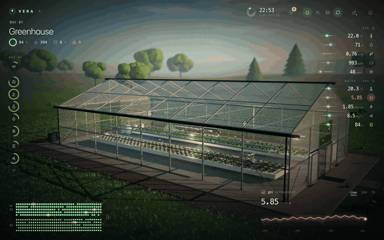
</a>

<sub><strong>The whole control room is one WebGL scene.</strong> The orbit, canopy, readings, chart and layout map are all live.</sub>

</div>

<p align="center">
  <a href="#the-twin">The twin</a> ·
  <a href="#scope">Scope</a> ·
  <a href="#equipment">Equipment</a> ·
  <a href="#disease-watch">Disease watch</a> ·
  <a href="#plant-inspector">Plant inspector</a> ·
  <a href="#telemetry">Telemetry</a> ·
  <a href="#layout-map">Layout map</a> ·
  <a href="#screens">Screens</a> ·
  <a href="#architecture">Architecture</a> ·
  <a href="#quickstart">Quickstart</a> ·
  <a href="#hardware">Hardware</a>
</p>

---

<a id="the-twin"></a>

## The twin

Vera is one browser tab that behaves like a greenhouse control room. A single continuous 3D scene — glasshouse, rafts, crop, dosing bench, weather station and the field beyond — is wired to a simulated sensor network and a real control protocol.

It is not a dashboard with a picture behind it. The camera, the crop, the equipment, the readings and the layout map all share one coordinate system and one state.

| **42** sensors | **10** live metrics | **10** actuators | **4** cameras | **394** heads | **0** servers |
|:--:|:--:|:--:|:--:|:--:|:--:|
| simulated | air + water | bay → bed → row | rail + dome | two beds | static HTML |

Three ideas hold it together:

| A place, not a dashboard | Automation you can audit | The node is the safety layer |
|:--|:--|:--|
| Greenhouse → bed → row → plant. The breadcrumbs, camera, dock, readings and layout map follow the same selection, so a number always has a place. | Every control has an **auto** mode with a stated reason, a **manual** mode with a visible override, and a live arc that shows what is actually happening. | The firmware keeps a complete local controller. Browser overrides expire **120 seconds** after the last message, then the bed goes back to automation on its own. |

<a id="scope"></a>

## Scope: one selection, everywhere

<p align="center">
  <a href="assets/readme/scope.gif">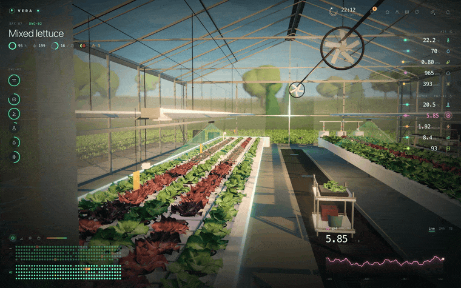</a>
</p>

The camera is not a set of fixed screens. It flies between views — curving through the doorway when it crosses the glass — and every panel re-renders against the new scope:

- **Greenhouse** — bay-wide climate, all ten metrics aggregated, both beds and every piece of equipment.
- **Bed** — one reservoir, one crop batch, one set of water readings and dosing targets.
- **Row** — a single variety and its own feed valve and light channel.
- **Head** — one plant, its health ring, growth record, root-zone readings, camera evidence and actions.

The layout map is a second navigation surface for the same scope: click a bed tag, a row or a single cell, and the scene and panels follow.

<a id="equipment"></a>

## Equipment: auto with a reason, manual with a receipt

Every control is a real state machine, not a slider wired to a number. Auto behaviour is inherited from the parent scope until you pin it by hand. Manual overrides turn amber, roll up into a top-level **N manual** pill, and can be released in one click.

| <a href="assets/readme/controls.gif">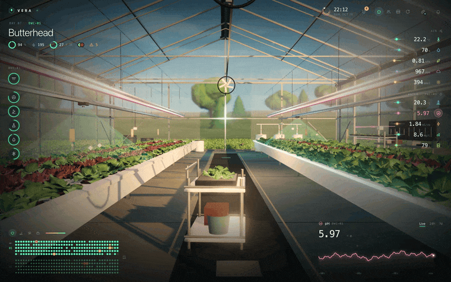</a> | <a href="assets/readme/dosing.gif">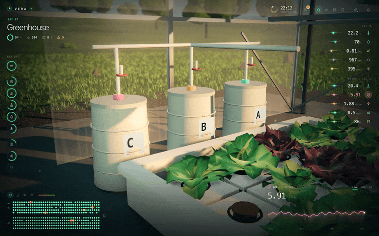</a> |
|:--:|:--:|
| **Auto / manual, at every scope.** Drag the grow-light slider and the LEDs dim in the scene. The dock arc, the override pill and the activity feed all update together. | **Dosing with a volume.** Nutrients A+B and pH− are targets, not sliders. Pick a volume, dose by hand, and watch the timeline, toast and activity log update. |

<p align="center"><sub>Ten controls · grow lights · recirculation · aeration · feed valve · nutrients A+B · pH− · chiller · roof vents · circulation fans · shade</sub></p>

What the scene actually does with the controls:

- **Grow lights** change LED emissive intensity and colour; the bay lightmap and canopy shading follow.
- **Recirculation** changes the water normal-map speed through each raft.
- **Aeration** shifts the dissolved-oxygen model.
- **Fans** spin the real fan models and feed the humidity and aphid-risk model.
- **Roof vents** shift humidity and air temperature in the climate model.
- **Chiller** shifts the solution temperature and the root-zone readings.

<a id="disease-watch"></a>

## Disease watch that closes the loop

<p align="center">
  <a href="assets/readme/disease.gif">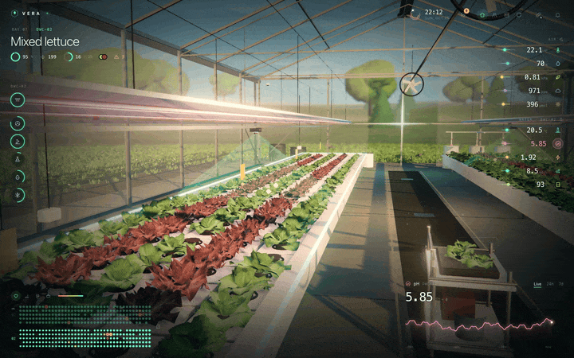</a>
</p>

Four cameras inspect the crop on a compressed pathology clock. Detections carry a disease, a confidence, a severity and a camera source. Risk is computed from the live climate and solution readings, not hard-coded.

- **Live rail feed** — a real second camera renders the canopy, with bounding boxes drawn over detected heads.
- **Four disease models** — downy mildew, Pythium root rot, tipburn and aphids, each with its own drivers, spread behaviour and severity.
- **Risk, not alarm** — the panel shows what is likely next, not only what has already been found.
- **A response that moves equipment** — “Dry the canopy” opens vents and fans; “Cool & oxygenate” drives the chiller and aeration; “Ease growth” dims lights.
- **Simulate 24 h** — fast-forward the pathology model with scans every 30 minutes and watch the map, list and risk bars update.

The camera evidence follows the same head into the plant inspector, so a detection is always attached to a place.

<a id="plant-inspector"></a>

## Plant inspector: a head with a history

<p align="center">
  <a href="assets/readme/inspector.gif">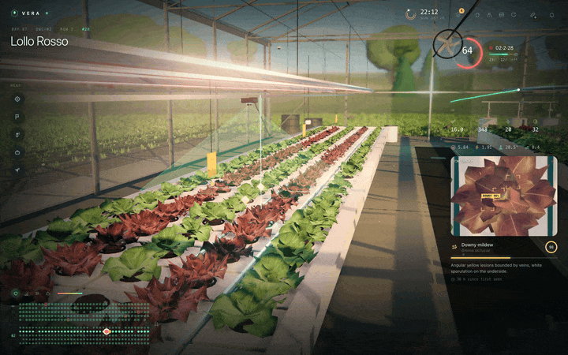</a>
</p>

The inspector is built for a single head:

- **Health ring** from colour, turgor and leaf area.
- **Growth curve** against an expected ±10% band for its age.
- **Camera snapshot** from the rail, with the detection boxes and confidence used by the model.
- **Root-zone readout** — pH, EC, water temperature and dissolved oxygen for the shared reservoir.
- **Actions** — look closer, flag, treat, mark for harvest or replace with a seedling. Each action writes an event and updates the map.

<a id="telemetry"></a>

## Telemetry: ten streams, one clock

<p align="center">
  <a href="assets/readme/telemetry.gif">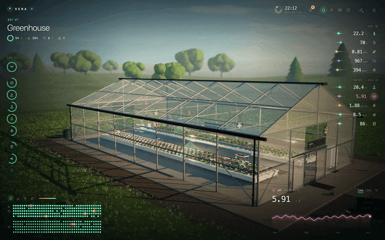</a>
</p>

Every reading is a deterministic function of wall-clock time, so the live stream, the 24-hour history and the in-scene control screen always agree. No backend, no database, no synthetic latency.

| Air | Water |
|:--|:--|
| Air temperature · humidity · VPD · CO₂ · PAR | Water temperature · pH · EC · dissolved oxygen · reservoir level |

Each metric has a target band, a smooth trend, a live sparkline and a focus chart with **live / 24 h / 7 d** ranges. Hover the chart for a timestamp and value; pH and EC show dosing marks right on the line. Keyboard: <kbd>[</kbd> and <kbd>]</kbd> cycle metrics.

<a id="layout-map"></a>

## Layout map: colour the canopy by what matters

<p align="center">
  <a href="assets/readme/map.gif">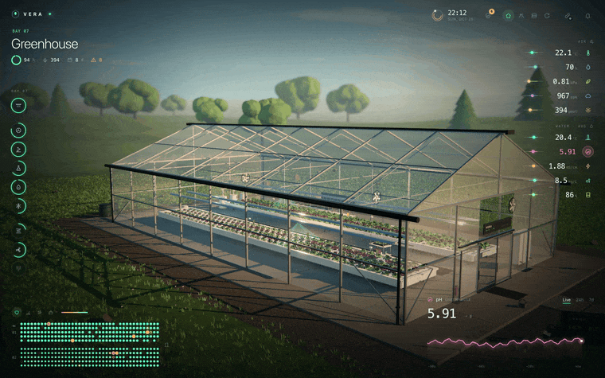</a>
</p>

The same 394 heads are drawn as a clickable plan. Four colour modes turn the map into a different question:

- **Health** — vision score per head.
- **Growth** — height against expected for its age.
- **Disease** — camera detections, with a ring for suspected heads.
- **Harvest** — days until ready; gold means this week.

The map mirrors the scope: rows dim, the selected bed is outlined, and the selected head gets a pulsing marker in both the plan and the 3D scene.

<a id="screens"></a>

## Screens

Every screenshot below is a live frame from the running twin, captured at **2400 × 1500**. Click any image for the full-size file.

| The aisle | From above |
|:--:|:--:|
| [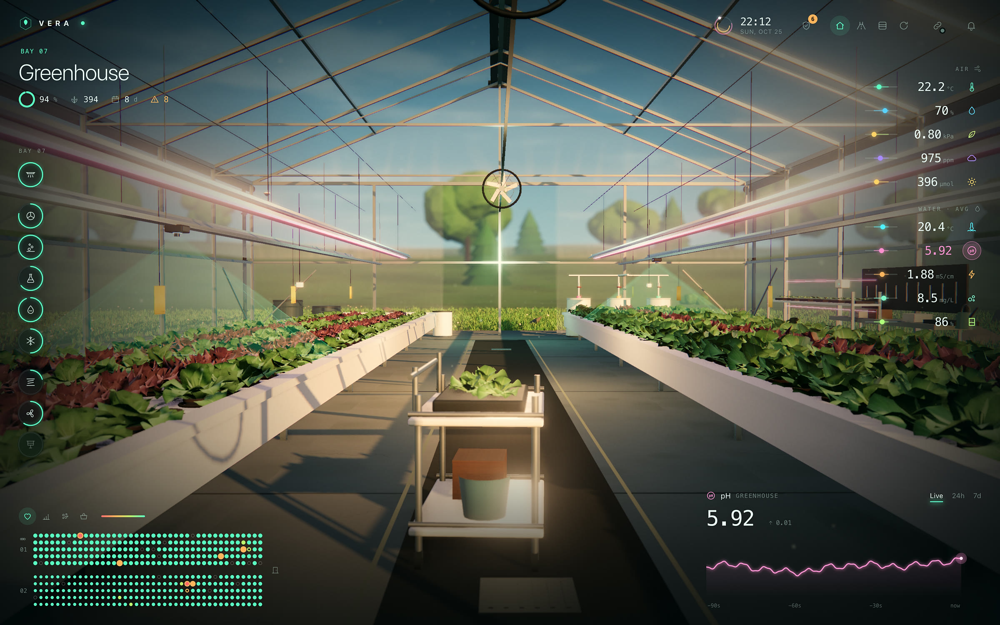](assets/screens/aisle.jpg) | [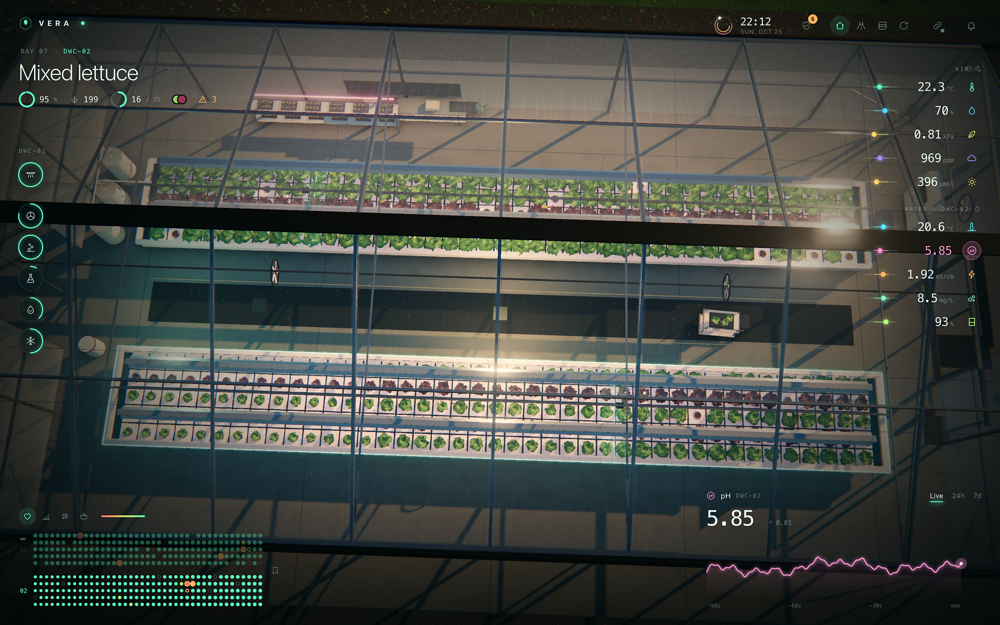](assets/screens/aerial.jpg) |
| **Walk the crop** — a continuous aisle between two rafts, with the weather station and dosing bench beyond. | **The whole bay** — two deep-water beds, the glasshouse, the field and the live layout map. |

| Equipment | Disease watch |
|:--:|:--:|
| [](assets/screens/control.jpg) | [](assets/screens/disease.jpg) |
| **Grow lights, pinned by hand** — the popover shows the 24-hour light plan and the override state. | **Camera evidence** — a live rail feed, risk bars, detections and a treatment response. |

| Plant inspector | Dosing bench |
|:--:|:--:|
| [](assets/screens/inspector.jpg) | [](assets/screens/dosing.jpg) |
| **One head, one record** — health, growth, camera evidence and root-zone readings. | **A measured dose** — pick a volume, dose, and watch the timeline and activity log update. |

<p align="center"><sub>More stills: <a href="assets/screens/overview.jpg">overview</a> · <a href="assets/screens/telemetry.jpg">24 h trend</a> · <a href="assets/screens/map.jpg">layout map</a></sub></p>

<a id="architecture"></a>

## Architecture

<p align="center">
  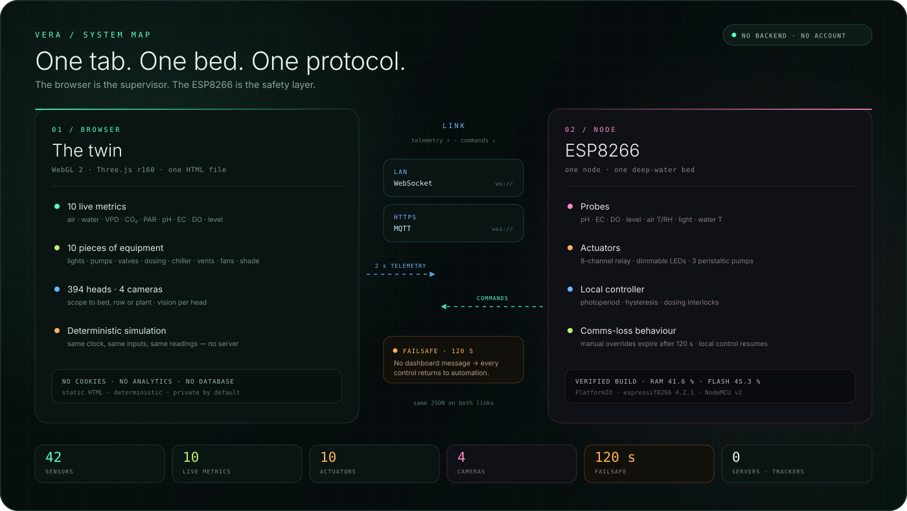
</p>

| | In the browser | On the node |
|:--|:--|:--|
| **Role** | Supervisor, visual twin, what-if surface | Local controller and safety layer |
| **State** | Deterministic simulation, 394 heads, pathology and vision | Real ADC probes, relays, pumps and LED dimming |
| **Loses the link** | Keeps simulating locally | Returns every control to automation after 120 s |
| **Needs a server** | No | No — the node is the server on the LAN |

The browser is intentionally not the safety layer. It can command a dose, but the firmware owns the interlocks, the mixing gap, the hourly cap and the comms-loss behaviour. See [`firmware/README.md`](firmware/README.md) for the relay map, calibration commands and protocol.

One command, one acknowledgement, on either link:

```json
{ "type": "set", "scope": "b0", "control": "lights", "mode": "manual", "level": 60, "ref": "ui-12" }
{ "type": "ack", "ref": "ui-12", "ok": true }
```

<a id="quickstart"></a>

## Quickstart

There is no build step and no install.

```bash
git clone https://github.com/Abhinav-Prabhakar/Vera.git
cd Vera
python3 -m http.server 8791
# open http://localhost:8791/
```

Any static server works: `npx serve .`, `bunx serve .`, nginx, GitHub Pages.

> Use `http://`, not `file://`. Three.js r160 is fetched from `unpkg.com` on first paint, and WebGL 2 is required (current Chrome, Edge, Firefox or Safari 15+). Give the glasshouse a moment to compile its shaders.

### Deep links

Append these to the local or live URL:

| Link | What it opens |
|:--|:--|
| [`?view=hero`](https://abhinav-prabhakar.github.io/Vera/?view=hero) | The establishing shot |
| [`?view=aisle`](https://abhinav-prabhakar.github.io/Vera/?view=aisle) · [`?view=aerial`](https://abhinav-prabhakar.github.io/Vera/?view=aerial) · [`?view=dosing`](https://abhinav-prabhakar.github.io/Vera/?view=dosing) | Aisle, aerial and dosing-bench cameras |
| [`?scope=b1`](https://abhinav-prabhakar.github.io/Vera/?scope=b1) · [`?scope=b1r2`](https://abhinav-prabhakar.github.io/Vera/?scope=b1r2) · [`?scope=det`](https://abhinav-prabhakar.github.io/Vera/?scope=det) | Bed, row and top-detection scopes |
| [`?watch`](https://abhinav-prabhakar.github.io/Vera/?watch) | Disease watch |
| [`?metric=ph&range=24h`](https://abhinav-prabhakar.github.io/Vera/?metric=ph&range=24h) | A metric and a time range |
| [`?pop=lights`](https://abhinav-prabhakar.github.io/Vera/?pop=lights) | An equipment popover |
| [`?mapmode=disease`](https://abhinav-prabhakar.github.io/Vera/?mapmode=disease) | A layout-map colour mode |
| [`?capture`](https://abhinav-prabhakar.github.io/Vera/?capture) | Static capture mode for screenshots |
| [`?quality=high`](https://abhinav-prabhakar.github.io/Vera/?quality=high) | Lock the high-quality render path |

Scope links update the selection and every panel; `?scope=det` also flies the camera to the highest-confidence detection.

Keyboard: <kbd>1</kbd> / <kbd>2</kbd> / <kbd>3</kbd> jump to hero, aisle and aerial · <kbd>A</kbd> toggles auto-orbit · <kbd>[</kbd> / <kbd>]</kbd> cycle metrics · <kbd>Esc</kbd> goes up one scope.

<a id="hardware"></a>

## Hardware

The ESP8266 firmware lives in [`firmware/vera-node`](firmware/vera-node) with its own [documentation, bill of materials, relay map, calibration commands and protocol](firmware/README.md).

| The device link | What changes when it connects |
|:--:|:--|
| <a href="assets/screens/link.jpg">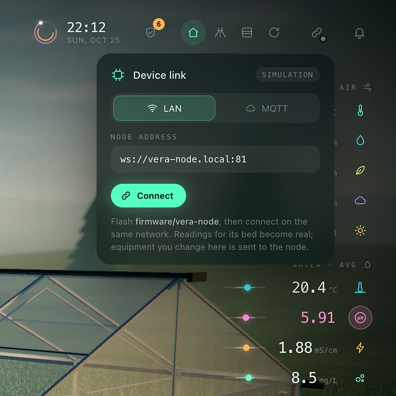</a> | **Simulation until you connect.** Pick the LAN WebSocket for local hardware, or MQTT over `wss://` from an HTTPS host. Once connected, readings for that bed become real, the node's equipment state is mirrored in the UI, and commands from the browser are acknowledged by the firmware. |

| The node reads | The node drives |
|:--|:--|
| pH · EC · dissolved oxygen · reservoir level · air temperature and humidity · light · water temperature | 8-channel relay board · dimmable LEDs · recirculation · aeration · chiller · feed valve · nutrient A/B pumps · pH− pump |

Each node owns one deep-water-culture bed. It runs a complete local controller, including dosing interlocks and a comms-loss failsafe. The browser is a supervisor, not the safety layer.

```bash
cd firmware/vera-node
cp src/vera_config.example.h src/vera_config.h   # add Wi-Fi + broker
pio run -t upload && pio device monitor
```

No hardware? The repo includes a zero-dependency mock node:

```bash
node tools/mock-node.mjs          # ws://localhost:8181
npx serve .                       # open Vera over http → link icon → LAN → ws://localhost:8181
```

> **HTTPS pages block `ws://`.** From GitHub Pages, use the MQTT `wss://` link. For the direct LAN WebSocket, open Vera over `http://` on the same network.

<a id="deploy"></a>

## Deploy

The site is published with GitHub Pages from [`.github/workflows/pages.yml`](.github/workflows/pages.yml). On every push to `main` it stages the static files and deploys them to:

**https://abhinav-prabhakar.github.io/Vera/**

[](https://github.com/Abhinav-Prabhakar/Vera/actions/workflows/pages.yml)

In the repository settings, **Pages → Build and deployment → Source** is set to **GitHub Actions**. The site also works from any static host; `.nojekyll` is included for branch-based Pages setups.

## Under the hood

- **One file.** The twin is a single `index.html` with inline CSS and an ES module. No bundler, no framework, no runtime install.
- **Rendering.** Three.js r160 with ACES tone mapping, GTAO, bloom, depth of field, a final grade pass, 4K sun shadows, procedural sky and textures, instanced grass and an adaptive quality path.
- **Simulation.** Seeded PRNG plus smooth analytic signals; readings are sampled from wall-clock time, so live, 24 h and 7 d views are the same model at different resolutions.
- **Pathology.** An epidemiological model per head, driven by climate and solution readings, with rail cameras on a compressed clock. One 40 s camera pass stands in for a 30 min scan interval.
- **Control protocol.** The same JSON over LAN WebSocket and MQTT; commands carry a `ref` and are acknowledged. Invalid doses are refused by the firmware, not silently dropped.
- **No tracking.** No cookies, no analytics, no account, no database.

The repo also includes small CDP helpers in [`tools/`](tools): `bench.mjs` for frame timings, `record.mjs` for a scripted tour, `cdp.mjs` for a minimal Chrome DevTools client and `mock-node.mjs` for the firmware link.

<a id="layout-of-the-repo"></a>

## Repository layout

```text
index.html                the twin: one WebGL scene, HUD and simulation
assets/
  readme/                 README GIFs, mark and system map
  screens/                full-size screenshots
  vera.gif                the hero loop above
  vera.mp4                the 39 s tour (1440 × 900, silent)
firmware/vera-node/       ESP8266 firmware and hardware notes
tools/                    CDP capture/benchmark helpers and a mock node
404.html                  GitHub Pages fallback
robots.txt, sitemap.xml   crawler metadata
site.webmanifest          install metadata and icons
.github/workflows/        GitHub Pages deployment
```

## Notes

- The greenhouse in the browser is a simulation for design, demo and monitoring work. Real dosing and safety decisions belong to the firmware's local controller.
- Three.js r160 is loaded from `unpkg.com`; an internet connection is needed for the first paint.
- No cookies, no analytics, no server-side component.
- The 39-second tour is in [`assets/vera.mp4`](assets/vera.mp4); the hero loop is [`assets/vera.gif`](assets/vera.gif).

---

<div align="center">

<sub>Built by <a href="https://github.com/Abhinav-Prabhakar">Abhinav Prabhakar</a> · <a href="https://abhinav-prabhakar.github.io/Vera/">open the twin</a> · <a href="firmware/README.md">flash a node</a></sub>

<sub>VERA · a greenhouse that keeps growing when the tab closes.</sub>

</div>
