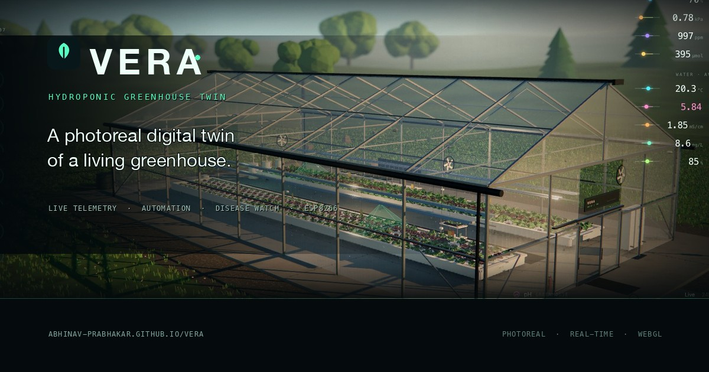
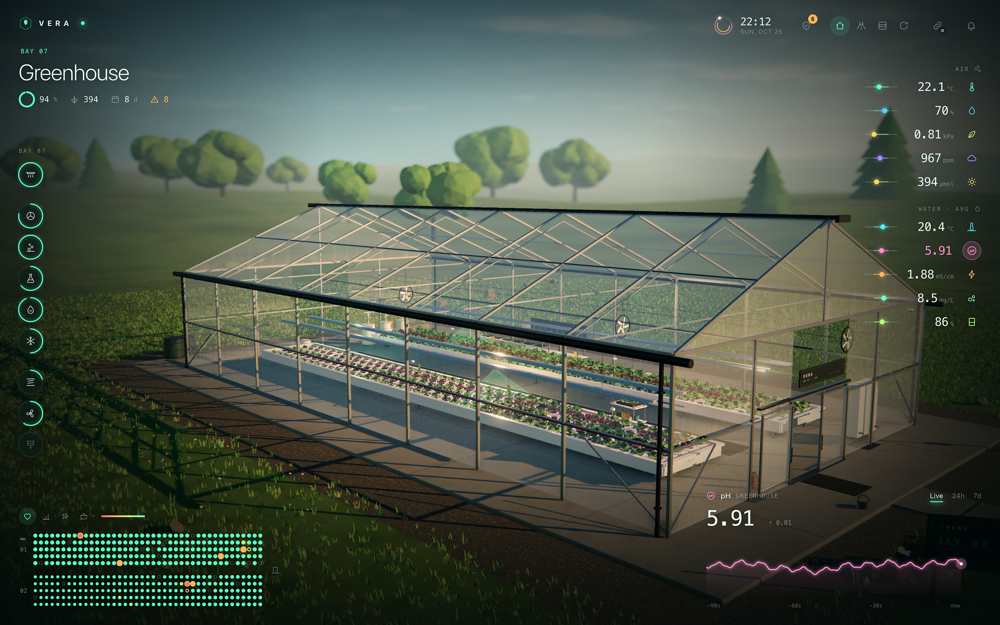
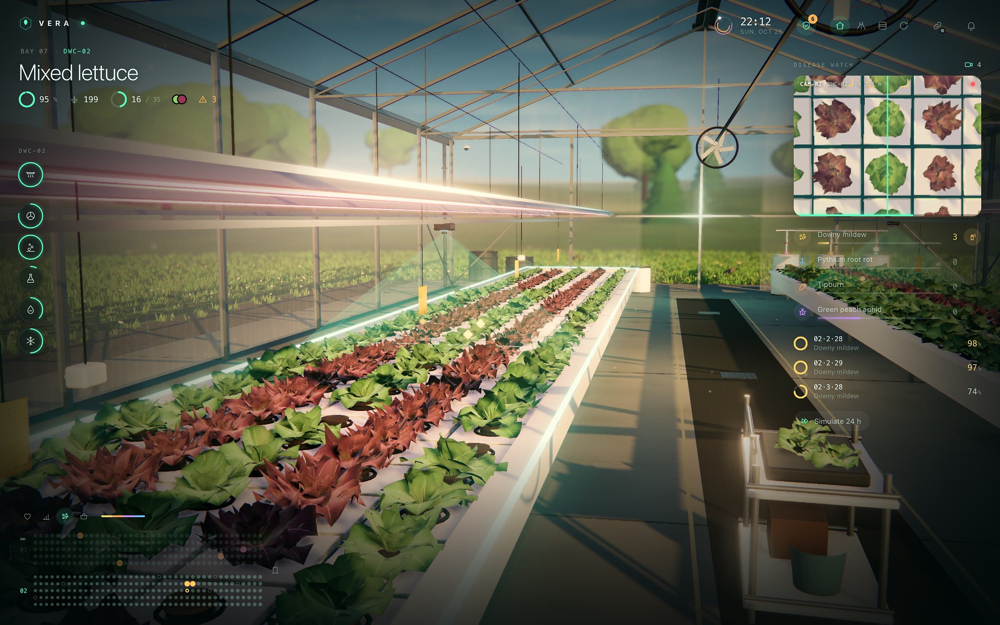
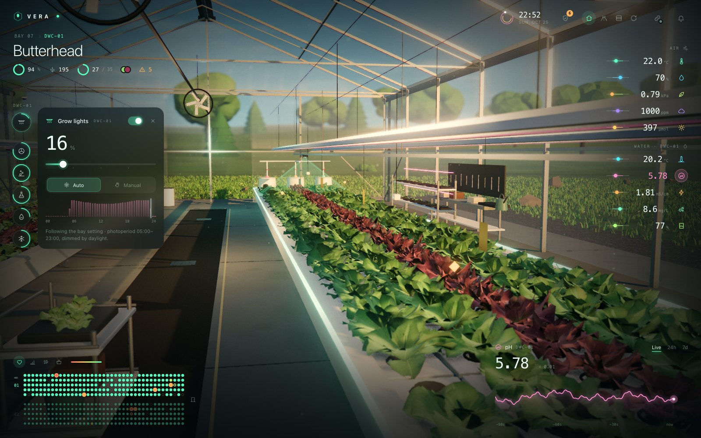
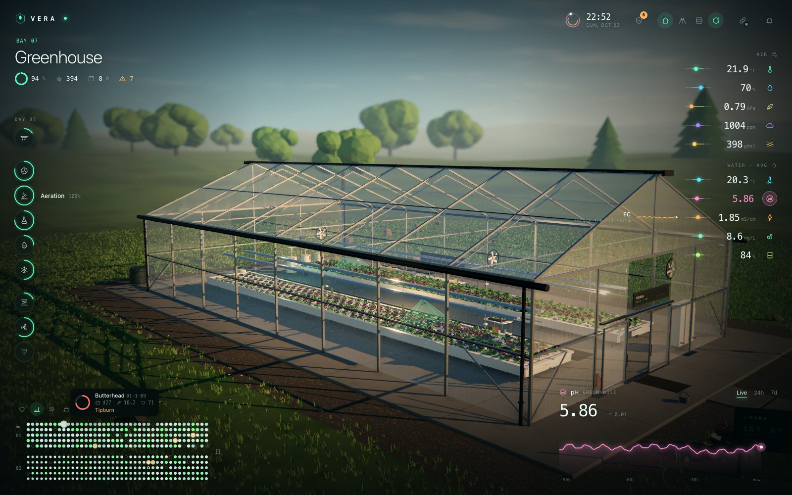
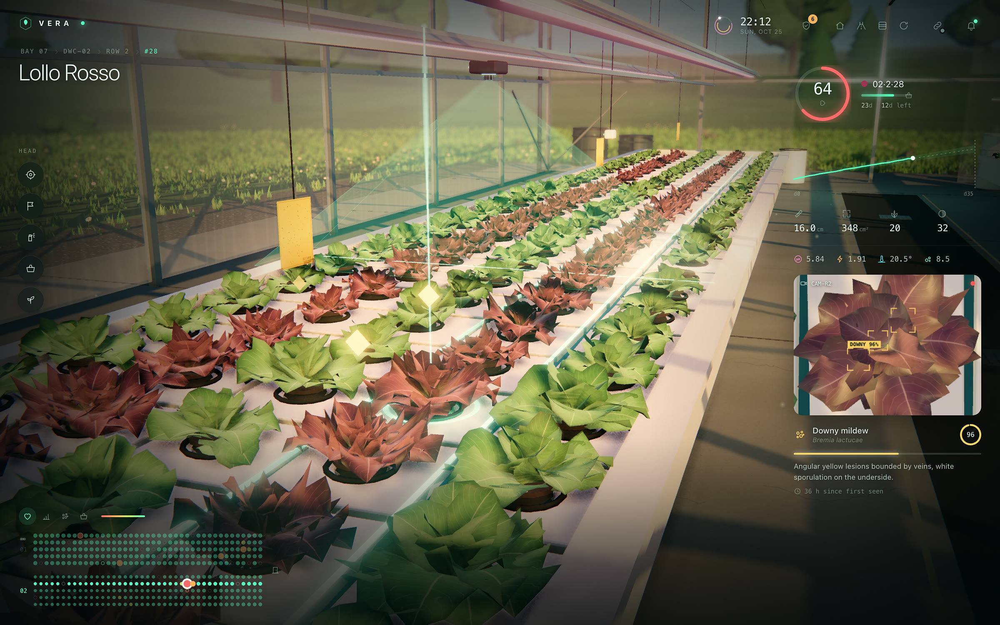
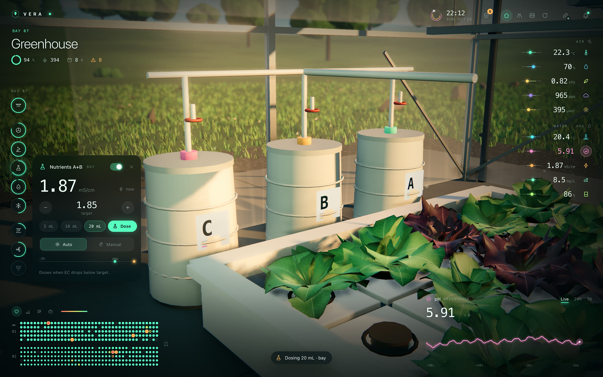

<div align="center">

# Vera

**A photoreal, real-time digital twin of a deep-water-culture hydroponic greenhouse.**

Ten live sensor streams, ten pieces of equipment you can actually drive, camera-based disease watch,
and an ESP8266 node that can take over the bed when the browser goes away.

[**Open the live twin →**](https://abhinav-prabhakar.github.io/Vera/)

[](https://abhinav-prabhakar.github.io/Vera/)

</div>

## What it is

Vera is one browser tab that behaves like a greenhouse control room. A single continuous 3D scene —
glasshouse, rafts, crop, dosing bench, weather station and the field beyond — is wired to a simulated
sensor network and a real control protocol.

- **Ten live metrics** — air temperature, humidity, VPD, CO₂, PAR, water temperature, pH, EC,
  dissolved oxygen and reservoir level — each with thresholds, smooth trends and a live / 24h / 7d
  chart.
- **A scope you can walk down** — greenhouse → bed → row → plant. Breadcrumbs, the layout map and the
  camera all follow the same selection, so a reading always has a place.
- **Equipment with automatic and manual modes** — grow lights, recirculation, aeration, feed valves,
  nutrient A+B dosing, pH-down dosing, chiller, roof vents, circulation fans and shade. Every control
  shows what automation is doing and why; every manual override is visible from the top level.
- **Disease watch** — a simulated camera feed, detections with confidence and severity, treatment
  actions, and camera evidence inside the plant inspector.
- **A hardware link** — connect an ESP8266 node over a LAN WebSocket or MQTT over secure WebSockets.
  The node keeps its own local controller and returns to automation 120 seconds after the last
  dashboard message.
- **No backend** — the twin is static HTML, CSS and JavaScript. The simulation is deterministic,
  local and private; there is no account, analytics or database.

## Screens

| Greenhouse | Disease watch |
| --- | --- |
|  |  |

| Equipment control | Layout map |
| --- | --- |
|  |  |

| Plant inspector | Dosing bench |
| --- | --- |
|  |  |

A short walkthrough is in [`assets/vera.mp4`](assets/vera.mp4) (9.5 MB, 1280×800). A smaller GIF
preview is in [`assets/vera.gif`](assets/vera.gif) (13 MB, 640×400).

## Run it locally

There is no build step. Serve the repository root over HTTP:

```bash
python3 -m http.server 8791
# http://localhost:8791/
```

or use any static server, for example `npx serve .`.

> Use `http://`, not `file://`, and give the page a moment on first load — Three.js is fetched from a
> CDN and the scene compiles its shaders before the loader clears. WebGL 2 is required (current
> Chrome, Edge, Firefox or Safari 15+).

Useful deep links:

| URL | What it opens |
| --- | --- |
| `/?view=hero` | The establishing shot |
| `/?view=aisle` · `/?view=aerial` | Aisle and aerial views |
| `/?scope=b1` · `/?scope=b1r2` · `/?scope=p123` | Bed, row and plant scopes |
| `/?watch` | Disease watch |
| `/?metric=ph&range=24h` | A metric and time range |
| `/?pop=lights` | An equipment popover |
| `/?capture` | Static capture mode for screenshots |

Keyboard: `1` / `2` / `3` jump to hero, aisle and aerial; `A` toggles the orbit; `[` and `]` cycle
metrics; `Esc` goes up one scope.

## Deploy

The site is published with GitHub Pages from the workflow in
[`.github/workflows/pages.yml`](.github/workflows/pages.yml). On every push to `main` it stages the
static files and deploys them to:

**https://abhinav-prabhakar.github.io/Vera/**

In the repository settings, Pages → Build and deployment → Source is set to **GitHub Actions**.
The site also works from any static host; `.nojekyll` is included for branch-based Pages setups.

## Hardware

The ESP8266 firmware lives in [`firmware/vera-node`](firmware/vera-node) and has its own
[documentation, bill of materials, relay map, calibration commands and protocol](firmware/README.md).

Each node owns one deep-water-culture bed. It reads pH, EC, dissolved oxygen, reservoir level, air
temperature and humidity, light and water temperature; drives a relay board and dimmable LEDs; and
runs a complete local controller, including dosing interlocks and a comms-loss failsafe. The browser
is a supervisor, not the safety layer.

From an HTTPS page such as GitHub Pages, browsers block `ws://`. Use the MQTT `wss://` link from the
hosted site, or open Vera over `http://` on the LAN for the direct WebSocket link.

## Repository layout

```
index.html               the twin: one WebGL scene, HUD and simulation
assets/                  social card, icons, screenshots and demo video
firmware/vera-node/      ESP8266 firmware and hardware notes
tools/                   CDP capture/benchmark helpers and a mock node
404.html                 GitHub Pages fallback
robots.txt, sitemap.xml  crawler metadata
site.webmanifest         install metadata and icons
.github/workflows/       GitHub Pages deployment
```

## Notes

- The greenhouse in the browser is a simulation for design, demo and monitoring work. Real dosing and
  safety decisions belong to the firmware's local controller.
- Three.js r160 is loaded from `unpkg.com`; an internet connection is needed for the first paint.
- No cookies, no analytics, no server-side component.

Built by [Abhinav Prabhakar](https://github.com/Abhinav-Prabhakar).
